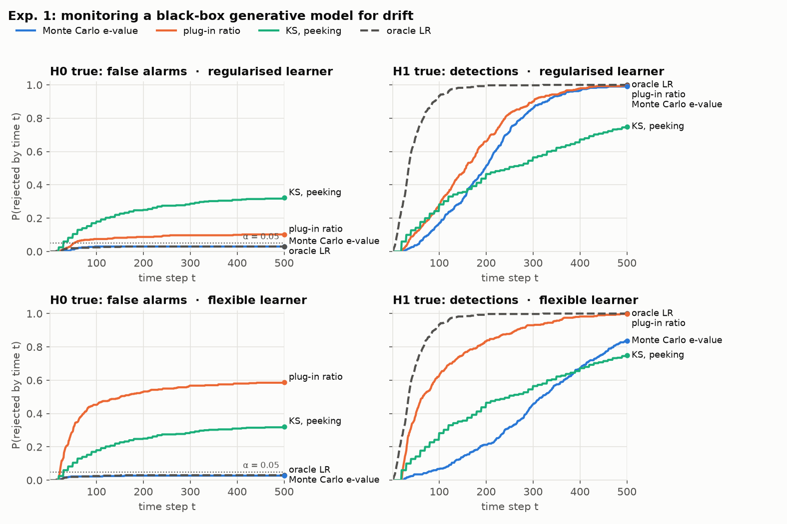
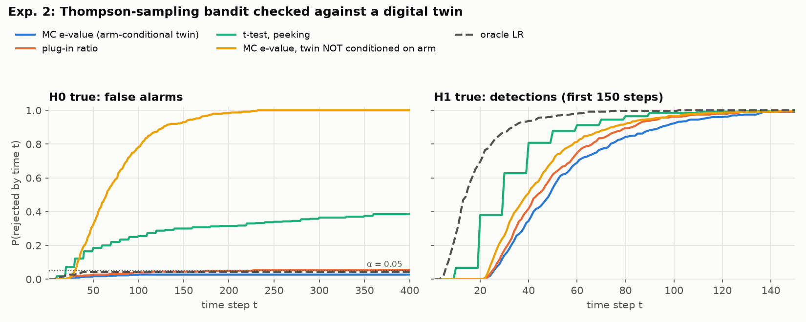
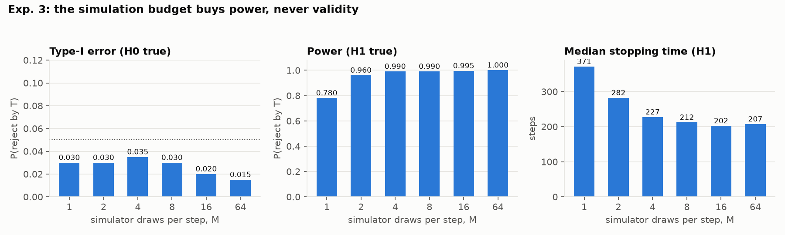
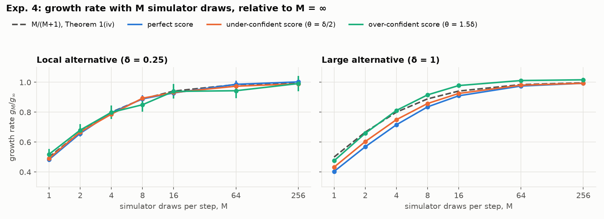
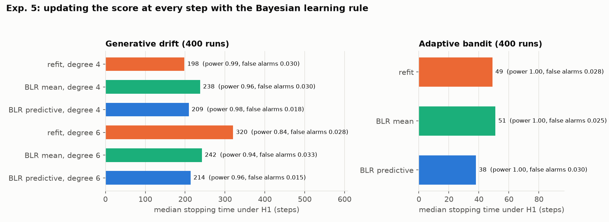

# evalues4generative

**Paper draft:** [`paper/main.pdf`](paper/main.pdf) (source in `paper/`).

A proof of concept for the research proposal *Simulation-Based E-Values and
Mixtures for Valid Inference in Dynamic and Adaptive Systems*.

**Question.** Can we monitor a stream of real data against a generative model
or simulator we can only *sample* from, with guarantees that hold at every
time step (anytime-valid) and under data-dependent (adaptive) allocation?

**Method (Proposition 2 of the proposal).** At step t, draw M samples
Y_1..Y_M from the simulator, conditional on the past and on the action taken.
Score them and the real observation X_t with a ratio estimator trained on the
past only. Then bet

    E_t = (M+1) T(X_t) / (T(X_t) + sum_j T(Y_j)),      T = exp(learned log-ratio).

Under H0, X_t and the Y_j are exchangeable, so E[E_t | past] = 1 *exactly*,
whatever the learner. The running product is therefore a test martingale:
reject when it reaches 1/alpha, at any time, with type-I error at most alpha
(Ville's inequality). No density is ever evaluated. To hedge the betting
fraction, the monitor averages the processes prod(1 - lam + lam E_t) over a grid
of lam values; that average is itself a test martingale.

The design follows the proposal's central principle: **the denominator carries
validity, the numerator carries power**. The learner only affects power.

## Results

alpha = 0.05. Rates are P(reject by the horizon). With 400 replications the
Monte Carlo standard error at 0.05 is about 0.011; with 200 it is about 0.015.

### Experiment 1: criticising a black-box generative model

The null simulator is a 2-D banana distribution (curvature b = 0.5). Under H1
the real data drift to b = 0.8. The drift changes neither the means nor the
marginal of x1, so the detector has to learn the shape of the discrepancy.
Horizon 500, M = 16, 400 replications.

| learner | method | false alarms (H0) | power (H1) | median stop (H1) |
|---|---|---|---|---|
| regularised (deg. 4, ridge 1) | **Monte Carlo e-value** | **0.030** | 0.990 | 198 |
| | plug-in learned ratio | 0.102 | 0.995 | 158 |
| | KS test, peeking every 10 steps | 0.323 | 0.750 | 250 |
| | oracle likelihood ratio | 0.030 | 1.000 | 35 |
| flexible (deg. 6, ridge 1e-3) | **Monte Carlo e-value** | **0.028** | 0.838 | 320 |
| | plug-in learned ratio | **0.588** | 0.998 | 66 |



With the same learner and the same data, using the learned ratio directly as
the bet gives 10% false alarms with a well-regularised learner and **59%** with
an overfitting one. Calibrating it against simulator draws keeps false alarms
at about 3% in both cases. The worse learner costs power, but never validity.

### Experiment 2: an adaptive bandit checked against a digital twin

Three arms are allocated by Thompson sampling on the real outcomes, with
skewed noise. The twin simulates any arm. Under H1, arm 0 is 0.5 better in
reality than the twin predicts. Horizon 400, M = 16, 400 replications.
Thompson sampling pulls the best arm 78% of the time under H0; under H1 it
pulls arm 0 65% of the time.

| method | false alarms (H0) | power (H1) | median stop (H1) |
|---|---|---|---|
| **Monte Carlo e-value, twin run on the chosen arm** | **0.028** | 1.000 | 49 |
| Monte Carlo e-value, twin run on random arms | **1.000** | 1.000 | 40 |
| plug-in learned ratio | 0.055 | 1.000 | 44 |
| per-arm Welch t-test, peeking | 0.388 | 1.000 | 30 |
| oracle likelihood ratio | 0.043 | 1.000 | 15 |



Adaptive allocation does not break the construction, provided the simulator
is run *conditionally on the action actually taken*. If the simulator ignores
the action, exchangeability fails and the test rejects a true null every time.
This is exactly the requirement stated in the proposal (Risk (i)).

### Experiment 3: what the simulation budget buys

Setup as in Experiment 1 (regularised learner), with M varied; 200
replications.

| M | 1 | 2 | 4 | 8 | 16 | 64 |
|---|---|---|---|---|---|---|
| false alarms (H0) | 0.030 | 0.030 | 0.035 | 0.030 | 0.020 | 0.015 |
| power (H1) | 0.780 | 0.960 | 0.990 | 0.990 | 0.995 | 1.000 |
| median stop (H1) | 371 | 282 | 227 | 212 | 202 | 207 |



The method is valid for every M, including M = 1. Power saturates quickly: M = 4
already comes close to M = 64.

### Experiment 4: checking the growth-rate theorem

The growth-rate result is Theorem 1 in the proposal. Here the null is
N(0, 1), the alternative N(δ, 1), and the score T(x) = exp(θx), so every
quantity in the theorem has a closed form, and the growth rate g_M is
estimated from 400,000 draws. Results:

- **Parts (i) and (iii) hold in every case tested:** the ceiling KL(Q‖P) and
  the finite-M lower bound. The lower bound is conservative.
- **Part (iv), local efficiency g_M / g_∞ ≈ M/(M+1), matches to within Monte
  Carlo error for δ = 0.25:** 0.48 / 0.66 / 0.80 / 0.89 / 0.93 at
  M = 1 / 2 / 4 / 8 / 16, against 0.50 / 0.67 / 0.80 / 0.89 / 0.94 predicted.
- **For a large shift (δ = 1) a perfect score does a little worse than
  M/(M+1)** (0.40 at M = 1).
- **An overconfident score can do better at finite M than at M = ∞.** With
  θ = 2δ, g_∞ = 0 but g_4 ≈ 0.18. The Monte Carlo e-value is capped at M+1,
  which tempers the score's bets.



In practice, one simulator draw per real observation roughly halves the growth
rate and doubles the time to detection; M ≈ 9 keeps 90%. Experiment 3 agrees:
the median stopping time at M = 1 is 1.8 times that at M = 64.

### Experiment 5: updating the score at every step with the Bayesian learning rule

In experiments 1–4 the learner was refitted every 10 steps, after a 20-step
burn-in. `e4g.BLRRatio` replaces that with a Gaussian posterior over the
real-vs-simulator ratio model, updated at **every** step by one
natural-gradient step. This is the Bayesian learning rule (Khan & Rue, JMLR
2023) in its online form (BONG; Jones, Chang & Murphy, NeurIPS 2024). There
is no burn-in and no refitting, and each update costs O(d²). The bet uses
either:
- the **posterior predictive** log-odds, κμ, which shrink the bet where the
  posterior is uncertain; or
- the **posterior mean**, μ.

The seeds are the same as in experiments 1–2, so the real data are identical;
400 replications each.

| task | learner | false alarms | power | median stop (H1) |
|---|---|---|---|---|
| drift, degree 4 | refit point estimate | 0.030 | 0.990 | 198 |
| | BLR, posterior mean | 0.030 | 0.965 | 238 |
| | **BLR, predictive** | 0.018 | 0.983 | 209 |
| drift, degree 6 (flexible) | refit point estimate | 0.028 | 0.838 | 320 |
| | BLR, posterior mean | 0.033 | 0.940 | 242 |
| | **BLR, predictive** | 0.015 | **0.965** | **214** |
| bandit | refit point estimate | 0.028 | 1.000 | 49 |
| | BLR, posterior mean | 0.025 | 1.000 | 51 |
| | **BLR, predictive** | 0.030 | 1.000 | **38** |



- **Predictive beats posterior mean in every setting.** Shrinking under
  uncertainty is what Theorem 1 asks for, since overconfident scores lose
  growth.
- **The Bayesian predictive makes the method insensitive to feature
  flexibility.** With degree-6 features, the refit learner overfits
  (power 0.84, median 320), while BLR-predictive nearly matches the degree-4
  results (0.965, median 214).
- **It is the fastest learner in the bandit** (median 38 vs 49).
- **With well-regularised degree-4 features it is on par with refitting**
  (median 209 vs 198), at a fraction of the computational cost.
- **The ratio-scale predictive, log E_q[exp(eta)] = mu + v/2, is the worst
  score everywhere** (experiment 5b): power 0.74–0.81 on drift, and a median
  stop of 106 vs 38 in the bandit. It is valid, but its uncertainty premium
  over-bets under an approximate posterior.
- **Validity is unchanged, as it must be.** But the posterior does not make
  the plug-in bet valid: using the learned ratio directly as the bet still
  gives 14–74% false alarms with BLR scores.

Proposition 3 of the proposal explains why predictive scores are the right
target. Under an exponential tilt of the simulator, and with unlimited
simulations, the Monte Carlo e-process with posterior-predictive scores is
exactly the Bayes factor. The total learning cost is then (d/2) log t.

### Experiment 6: head-to-head with the Besag–Clifford e-process

This is the drift task (an i.i.d. null, so the method of Dombowsky et al. 2026
applies), with identical data and simulator draws, M = 16, and 400
replications. Entries are median stopping times under H1; power is in
brackets where it is below 1.

| statistic (what it needs) | all-in (λ = 1) | aGRAPA | our λ-mixture |
|---|---|---|---|
| likelihood ratio (both densities + true alternative) | **36** | 66 | 48 |
| plug-in MLE (density of the parametric family) | 58 | 86 | 68 |
| BLR predictive (**simulator samples only**) | — (0.41) | 289 (0.94) | **209** (0.98) |

False alarms are at most 4.5% everywhere.
- When their statistic is available, their method is 3.5–6 times faster.
- With a learned score, all-in betting fails, and our λ-mixture is the right
  choice.
- In the adaptive bandit their i.i.d. formulation rejects a true null in every
  run (experiment 2).

## Novelty

See [LITERATURE.md](LITERATURE.md). In short, the parts are known: Besag–Clifford
exchangeability, testing by betting, classifier-based ratios, and per-step null
sampling for conditional independence (Shaer et al., 2023). The combination is
what we believe is new: a stream, a simulator-only null, adaptive actions and
learned scores, together with the growth theory. After reading the full text of Dombowsky, Engelhardt & Ramdas (2026, v2),
the sequential e-process for an i.i.d. null and the finite-M bound are
theirs. What is ours: adaptive actions (and the necessity of conditioning on
them), learned and predictive scores, the local constant M/(M+1), and the
Bayesian learning rule. See LITERATURE.md.

## What this does and does not show

- **Shown.**
  - Exact validity with a simulator-only null, for arbitrary and even badly
    overfitting learners, under optional stopping and adaptive allocation.
  - The failure of the two naive alternatives: using a learned ratio directly
    as the bet, and repeated fixed-sample tests.
  - The necessity of simulating conditionally on the action.
- **Price of validity.**
  - The Monte Carlo e-value is well behind the oracle likelihood ratio (median
    stopping time about 200 vs 35 in Experiment 1). The cost comes from
    learning the ratio online: no bets are placed during the first 20 steps,
    and the learner is refitted every 10 steps.
  - When the plug-in happens to be nearly calibrated (Experiment 2), it is
    slightly faster, but it has no guarantee.
  - Closing the gap to the oracle is RQ2 in the proposal.
- **Not covered yet.**
  - Composite or nuisance-parameter nulls (RQ3).
  - High-dimensional generative models, such as images or text embeddings.
  - Adaptive choice of M, and reuse of simulations across steps (RQ1).
  - Symmetry-based speed-ups (RQ4).

## Layout and reproduction

```
LITERATURE.md       related-work table and novelty claims
e4g/evalues.py      Monte Carlo factor, plug-in factor, lambda-mixture, product process
e4g/learners.py     online balanced logistic ratio estimator (polynomial features);
                    BLRRatio, Bayesian-learning-rule posterior updated every step
e4g/monitor.py      runs the competing e-processes side by side
experiments/        exp1_generative_drift.py, exp2_adaptive_bandit.py,
                    exp3_simulation_budget.py, exp4_growth_rate.py,
                    exp5_bayesian_learning_rule.py, make_figures.py
tests/              exactness tests (E[E_t] = 1 for arbitrary scores, etc.)
results/            JSON results and run logs; figures/  PNG figures
```

```bash
pip install -r requirements.txt
python -m pytest -q tests                        # ~30 s
python experiments/exp1_generative_drift.py      # ~10 min on 4 cores
python experiments/exp2_adaptive_bandit.py       # ~2.5 min
python experiments/exp3_simulation_budget.py     # ~4 min
python experiments/exp4_growth_rate.py          # ~2 min
python experiments/exp5_bayesian_learning_rule.py  # ~25 min
python experiments/exp5b_predictive_scales.py      # ~10 min
python experiments/exp6_compare_besag_clifford.py  # ~4 min
python experiments/make_figures.py
```

All runs are seeded (replication i uses seed i under H0 and 10^6 + i under H1),
so reruns reproduce the tables exactly.
